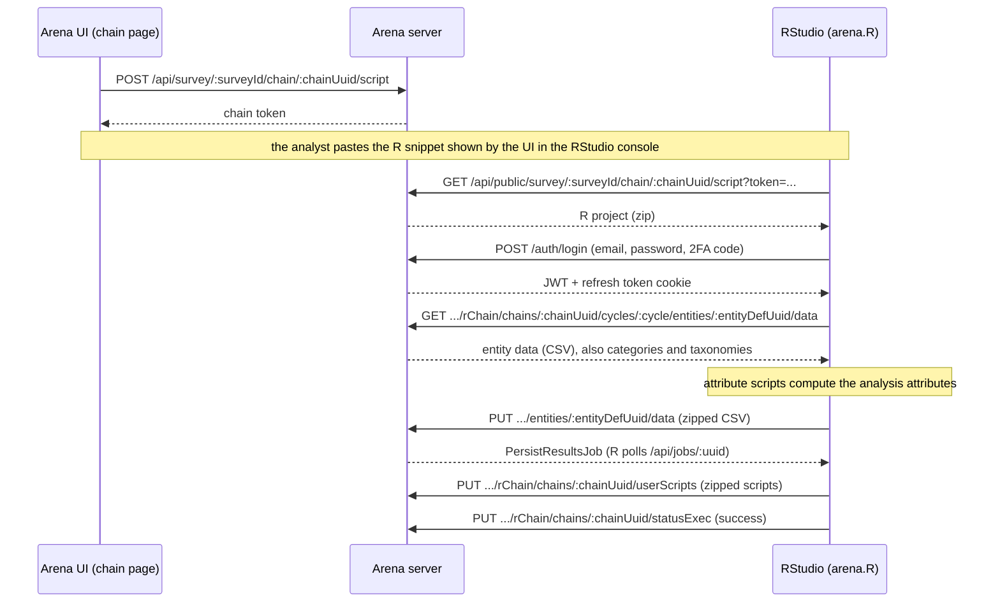

# Analysis chains

An analysis chain (called "processing chain" in older code and in some routes) computes new attributes
from the collected data with R scripts and, optionally, runs a statistical analysis based on a sampling
design. Arena never runs the chain's R code itself: it generates an RStudio project, the analyst runs it
in RStudio, and the scripts read the data from Arena and send the results back through the Arena REST
API. This document explains the pieces of a chain, that round trip, and where each step lives.

## What a chain is made of

- **The chain**: a row of the `survey_<id>.chain` table (`TableChain` in `common/model/db/tables/chain/`),
  modelled by `common/analysis/chain.js`. Besides labels and descriptions it holds:
  - the RStudio options: send only records in the analysis step (`submitOnlyAnalysisStepDataIntoR`),
    only some records (`submitOnlySelectedRecordsIntoR` + `selectedRecordUuids`), include entities without
    data (`includeEntitiesWithoutData`), import the results back (`resultsBackFromRStudio`, default on);
  - `scriptCommon` / `scriptEnd` (`script_common` / `script_end` columns): R code run before and after
    the attribute scripts;
  - the sampling design and statistical analysis settings (below);
  - the last execution: `statusExec` and `dateExecuted`, set by the R scripts when they complete.
    `Chain.isDraft` is true when the chain was never run or was modified since.
- **Analysis attributes** ("result variables"): ordinary node defs with `analysis: true` (column of
  `node_def`), quantitative (decimal) or categorical (code), created from the chain page
  (`webapp/store/ui/chain/actions/createNodeDef.js`) and edited in the node def editor (entity selector,
  `RScriptEditor`, area-based estimate toggle in `webapp/components/survey/NodeDefDetails/`). They sit in
  the survey hierarchy under the entity they are computed for and belong to one chain through their
  advanced props: `chainUuid`, `script` (the R code), `index` (execution order in the chain) and `active`
  (inactive ones are not computed). `core/survey/_survey/surveyAnalysis.js` has the selectors:
  `Survey.getAnalysisNodeDefs`, `Survey.getAnalysisEntities`, `Survey.getBaseUnitNodeDef`.
- **Sampling design** (optional, `hasSamplingDesign`; the UI allows it on one chain per survey,
  `ChainBasicProps`). Its props are in `common/analysis/chainSamplingDesign.js`:
  - the **base unit** entity (e.g. the plot), the unit the sampling design and the weights refer to;
  - the sampling strategy: simple random, systematic, stratified random, stratified systematic, two-phase;
  - the stratum attribute (stratified strategies only), post-stratification attribute, clustering
    entity, area weighting method;
  - for two-phase sampling, the phase 1 category and the join attributes;
  - the reporting data category, with an attribute for each of its levels.

  `cleanupSamplingDesign` drops the props the selected strategy doesn't use. The statistical analysis
  settings (`common/analysis/chainStatisticalAnalysis.js`: reporting entity, dimensions, filter, p-value,
  reporting method and area, non-response bias correction, clustering-only variances) are only used by
  the statistical analysis step. The base unit also drives the auto-generated `weight` and plot area
  attributes: see [sampling-plot-area-node-defs.md](sampling-plot-area-node-defs.md).

- **Cycles**: a chain is not tied to a cycle. Analysis attributes get all the survey cycles (on creation
  and again on every publish). The R project is generated for the cycle selected in the UI, and data are
  read and results written for that cycle only.

## Chains and survey publishing

Analysis attributes are node defs, so creating or editing them marks the survey as draft; changing the
base unit does too (`Chain.checkChangeRequiresSurveyPublish`, `server/modules/analysis/service/update.js`).
RStudio can only be opened on a published survey (`checkCanOpenRStudio` in
`webapp/store/ui/chain/actions/openRStudio.js`): R reads the data from the RDB, which is rebuilt on
publish. `SurveyPublishJob` runs three chain jobs (`server/modules/survey/service/publish/jobs/`) before
the RDB is regenerated:

- `ChainsCyclesCheckJob`: assigns all survey cycles to every analysis attribute;
- `ChainsSamplingNodeDefsCheckJob`: creates or deletes the `weight` and plot area attributes;
- `ChainsValidationJob`: fails the publish if a chain has no label in the default language or no
  analysis attribute (`common/analysis/chainValidator.js`).

## Running a chain in RStudio

The RStudio buttons of the chain page (`ChainRStudioPanel`) dispatch `openRStudio`, which calls
`POST .../chain/:chainUuid/script` (`server/modules/analysis/api/chainApi.js`): it creates a chain
token, generates the project and returns the token. The UI then shows an R snippet (copied to the
clipboard on OK) that downloads the project from the public `GET /api/public/.../script` route. That
route regenerates the project and sends it as a zip; the server URL written into the scripts
(`arena.host`) is the one of this download request (`Request.getServerUrl`, switched to https except
for localhost), so R calls back the URL it downloaded from.

- **RStudio (cloud)**: `POST /api/rstudio` (`server/modules/rstudio/api/rstudioApi.js`) asks the RStudio
  pool service (`RSTUDIO_POOL_SERVER_URL`, `RSTUDIO_POOL_SERVICE_KEY`) for an instance for the current
  user, and the UI opens `<rStudioProxyUrl><instanceId>_<userUuid>`. Without a pool service the API
  returns nothing and the UI opens `/rstudio/` on Arena's own host: one RStudio shared by all users
  (see [infra/k8s/README.md](../infra/k8s/README.md)). The snippet first clears the RStudio workspace
  and working directory, then unzips the project there and opens `arena.R`. Canceling the dialog
  terminates the instance if it was created for it.
- **RStudio (local)**: the snippet unzips the project into `~/arena/arena-<survey name>-<timestamp>` and
  opens it as an RStudio project (its `.Rprofile` then opens `arena.R`). The local RStudio must reach
  the Arena server: in development, `RSTUDIO_DOWNLOAD_SERVER_URL` (read by the webapp at build time)
  replaces the server URL in the snippet, e.g. with a tunnel to localhost.

## The generated R project

`RChain.init` (`server/modules/analysis/service/rChain/rChain.js`) deletes and rewrites the project in
`ANALYSIS_OUTPUT_DIR/<survey name>/<chain folder>/`. The chain folder name (`rChain/rChainDir.ts`) is the
chain label in the survey default language normalized like a node definition name (lowercase letters,
digits and underscores) plus the first 8 characters of the chain uuid, e.g. `volume_calc_3f2a9b1c` (only
the uuid part if no character of the label is kept); generation fails if `ANALYSIS_OUTPUT_DIR` is not set
or the folder does not resolve inside it. Each R file is an `RFile` subclass (`rChain/rFile/`) whose
`init` writes the file and appends a `source(...)` of it to `arena.R`, the entry point; the R code
strings come from the helpers in `rChain/rFunctions/`. `chain_summary.json` (`ChainSummaryGenerator`,
also downloadable from the chain page) carries the chain, sampling design and statistical analysis
settings, loaded in R as `arena.chainSummary`. `arena.R` runs, in order:

1. `system/init.R`: installs/loads packages, defines the API helpers (`system/init/init-api.R`) and sets
   `arena.host` and `arena.token`.
2. `system/login.R`: logs in (see below).
3. `system/read-data.R`: one data frame per analysis entity, named after the entity, from
   `GET .../entities/:entityDefUuid/data` (`rChainApi.js` → `fetchNodeData` →
   `SurveyRdbManager.fetchViewData`): a CSV of the entity's RDB data view (its attributes plus its
   ancestors' ones), without analysis attributes, filtered by record step and selected records according
   to the chain options. Also one data frame per multiple attribute, the `categories` and `taxonomies`
   lists and `arena.schemaSummary`. The entities are those of `Survey.getAnalysisEntities` (root or
   multiple entities with analysis attributes of this chain, plus the clustering entity) in the cycle,
   and, unless `includeEntitiesWithoutData`, with data.
4. `user/000-common.R` (chain `scriptCommon`), then `sampling/*.R` (weight and plot area), then one
   `user/NNN-<entity>-<attribute>.R` per active analysis attribute, in chain order. Each one assigns a
   column of the entity data frame (e.g. `tree$volume <- ...`); an empty script assigns `NA`.
5. `system/calculate-results.R` (`DfResults`, `rFile/system/dfResults.js`): for every entity with active
   analysis attributes (and the base unit) builds `<entity>Results` with the analysis columns plus
   `chain_uuid`, `record_uuid` and `parent_uuid` (the entity node); code attributes get `_code`, `_label`
   and `_uuid` columns from the category items.
6. `system/persist-results.R`: for each entity writes the results CSV, zips it, `PUT`s it to
   `.../entities/:entityDefUuid/data` and waits for the server job. Its `source` line is commented out
   when "results back from RStudio" is off.
7. `system/statistical-analysis.R` (only with a sampling design): sources `arena_analysis_for_Shiny.R`
   from the [r-arena](https://github.com/openforis/r-arena) repository and runs
   `arenaAnalytics_LowAggData()`. Its output files stay in the RStudio working directory.
8. `user/999-common-end.R` (chain `scriptEnd`).
9. `system/persist-user-scripts.R`: zips `sampling/` and `user/` and `PUT`s them to `.../userScripts`;
   `persistUserScripts` (`rChain/index.js`) saves them back into the chain (`scriptCommon`, `scriptEnd`)
   and the attributes (`script`) without marking the survey as draft, so script edits made in RStudio
   are kept in Arena.
10. `system/close.R`: `PUT .../statusExec` with `success` (`updateChainStatusExec`: sets `status_exec`,
    `date_executed` and an activity log entry), then logs whether the chain ran with errors.

A failing data or user script doesn't stop `arena.R`: its `source` is wrapped in a `tryCatch` that
records the error (`saveError` in `system/init/init-handle-errors.R`), and the persist steps (6 and 9)
then don't run (`checkGlobalErrors`).

## Authentication of the R scripts

Every call from R carries two credentials:

- **The chain token.** `generateRStudioToken` (`server/modules/analysis/service/rStudio/index.js`)
  creates a random token bound to the chain, valid for 48 hours. The scripts send it as the `token`
  query parameter (`arena.prepareQueryParams` in `init-api.R`) and every `rChainApi.js` route checks it
  with `checkRStudioToken`. The project download route is under `/api/public/` (no login) and relies on
  this token only. Tokens are kept in the memory of the server process that created them, not in the
  database: a server restart invalidates them (the analyst clicks the RStudio button again), and so does
  a request reaching another server instance.
- **A user session.** The `rChain` routes also require a logged-in user with analysis permission
  (`AuthMiddleware.requireRecordAnalysisPermission`; survey view permission for categories and
  taxonomies). `arena.login()` asks for email and password (and the 2FA code, if enabled) with
  `rstudioapi` dialogs and posts them to `/auth/login` (an arena-server route). The returned JWT is sent
  as `Authorization: Bearer`; on a 401, `arena.handleUnauthorizedAndRetry` refreshes it through
  `/auth/token/refresh` (refresh token cookie) and, if that fails, asks to log in again. Running
  `arena.R` again in the same R session skips the login (`arenaLogin`).

## Where the results go

`PUT .../entities/:entityDefUuid/data` starts a `PersistResultsJob`
(`server/modules/analysis/service/rChain/PersistResultsJob.js`), a `FlatDataImportJob`: for every CSV
row it finds the record by `record_uuid` and the entity by `parent_uuid`, sets the analysis attribute
values and persists them like any data import, as nodes in `survey_<id>.node` and in the entity's RDB
table `survey_<id>_data.data_<entity>`, which has a column for each analysis attribute. Results are
therefore ordinary attribute values: the data explorer (`webapp/components/DataQuery`) lists analysis
attributes and can filter them by chain, and data exports can include them (`includeAnalysis` option).

Two other outputs exist but are not written by the flow above:

- `PUT .../cycles/:cycle/olap-data` (`PersistOlapDataJob`) loads `OLAP_<entity>.csv` files into the
  `survey_<id>_data.olap_data_cycle_<cycle>_<entity>` tables, created with the RDB
  (`SurveyRdbOlapDataTablesCreationJob`); no script generated by Arena calls it.
- A MAU zip (produced by the statistical analysis for the Arenalytics Shiny tool) can be uploaded by hand
  from the chain page's advanced functions menu; it is stored as a survey file per chain and cycle
  (`server/modules/analysis/service/chainMauFile.js`).
