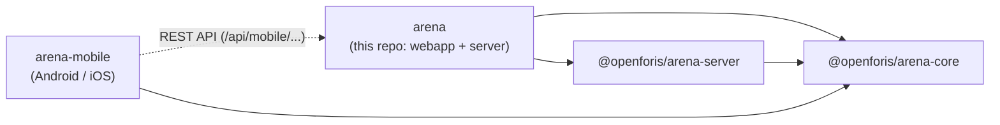

# Architecture overview

How the Arena pieces fit together. For the folder layout and coding conventions see
[CLAUDE.md](../CLAUDE.md); this page covers what the folder tree doesn't show.

## Repositories

| Repository | What lives there |
| --- | --- |
| [arena](https://github.com/openforis/arena) | The web application (`webapp/`) and the server application (`server/`): API, jobs, imports/exports, analysis. |
| [arena-core](https://github.com/openforis/arena-core) | TypeScript domain model shared by every other piece: survey/node def/record types and utilities, record updater, validation, expression evaluation, `ServiceRegistry`. |
| [arena-server](https://github.com/openforis/arena-server) | Server foundation: Express app bootstrap (`ArenaServer`), DB connection and migrations, authentication, WebSocket server, cluster bus and locks, job/user/survey repositories and services. |
| [arena-mobile](https://github.com/openforis/arena-mobile) | Offline data collection app (React Native / Expo). Downloads survey packages and uploads records through the `/api/mobile/...` endpoints (`server/modules/mobile/`). |

Things to keep in mind:

- **One arena-core copy.** arena-server registers its services in the arena-core `ServiceRegistry`
  singleton; if arena and arena-server resolve different arena-core versions, arena doesn't see them.
  See "Single `@openforis/arena-core` version" in [CLAUDE.md](../CLAUDE.md).
- **Two domain models.** `core/` in this repo is the original JavaScript domain model (`Survey`,
  `NodeDef`, `Record`, ... modules); arena-core is the newer TypeScript one (`Surveys`, `NodeDefs`,
  `Records`, ...). Both work on the same plain JSON objects, so they can be mixed. New domain types and
  logic go to arena-core.
- **Changes spanning repos** (e.g. a new node def property used by both the web and the mobile app)
  usually start in arena-core: release it, then bump it in arena-server and in the apps.

## Server runtime

Entry point: `server/server.js` → `server/system/appCluster.js`, which:

1. creates the Express app with `ArenaServer.init` (arena-server); this also migrates the `public` DB
   schema;
2. registers the arena API routes (`server/system/apiRouter.js`), the static webapp bundle and Swagger
   (`/api-docs`, built from the `@swagger` comments in [api/](api/));
3. starts listening, then the schedulers (`server/system/schedulers/`) and the background job that
   migrates every survey's schema and data (`AllSurveysDataMigrationJob`).

Work that doesn't fit in a request runs elsewhere:

- **Jobs** (`server/job/`): imports, exports, publishing, validation, ... are jobs made of inner jobs.
  `JobQueue` runs them in worker threads with limited concurrency, persists their status in the `job`
  table and pushes progress to the client through the WebSocket.
- **Record updates** from the data entry form run in a single worker thread per server instance,
  shared by all surveys (`server/modules/record/service/update/surveyRecordsThreadService.js`); see
  [record-editing.md](record-editing.md).

**Multiple instances.** Several server instances can run against the same DB: they exchange events
through Postgres `LISTEN/NOTIFY` (`ClusterBus` in arena-server) and serialize boot-time and scheduled
work with advisory locks (`runWithClusterLock`). This needs S3 file storage and sticky sessions for
socket.io; see [infra/k8s/README.md](../infra/k8s/README.md).

## Database

PostgreSQL with PostGIS, accessed with pg-promise. Schemas:

| Schema | Content |
| --- | --- |
| `public` | Users, auth groups, user groups, surveys (with their info props), jobs, messages, cluster bus tables. |
| `survey_<id>` | The survey definition (node defs, categories, taxonomies, analysis chains), its records and nodes, files, activity log. |
| `survey_<id>_data` | The "RDB": one table per entity with one column per attribute, plus views. Generated from the survey definition and filled from the nodes; read by the data explorer, data exports and analysis. |

- **Draft vs published.** Survey definition rows have `props` (published) and `props_draft` (changes
  not yet published). The designer works on the draft; `SurveyPublishJob`
  (`server/modules/survey/service/publish/`) validates the survey, moves the draft props into `props`
  and regenerates the RDB schema. Repositories read one or the other with `mergeProps({ draft })`
  (`server/db/utils/mergeProps.js`).
- **Migrations** live in arena-server (`src/db/dbMigrator/migration/public` and `.../survey`); the
  survey ones run for every `survey_<id>` schema.
- **Files** (record attachments) are stored in the DB, on the file system or in S3, depending on the
  `FILE_STORAGE_*` environment variables (see `.env.template`).

## Webapp

React single page application with a Redux Toolkit store (`webapp/store/`). It talks to the server
through the REST API (`/api/...`, clients in `webapp/service/api/`) and a socket.io connection
(`webapp/app/appWebSocket.js`) for job progress, record updates and survey/user changes. Conventions:
[webapp-conventions.md](webapp-conventions.md).
