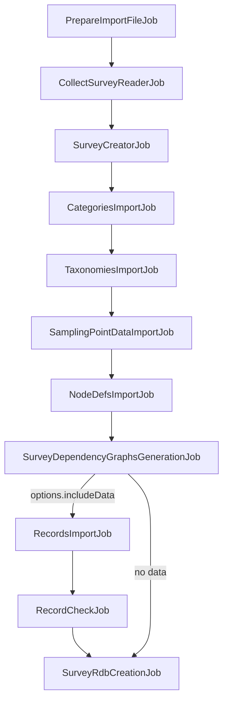

# Collect import

Arena can create a new survey from an Open Foris Collect file (`.collect`, `.collect-backup` or `.collect-data`, the
latter two also containing records), optionally importing its records, and can later import more Collect data into
that survey. This document explains the job chain, the order of its steps, where each one lives and the non-obvious parts.

An ODK importer mirroring this one lives in `server/modules/odkImport/` (design:
`docs/superpowers/specs/2026-09-09-odk-import-design.md`).

## Entry points

| Flow                                                                                                                            | API (handler file)                                                                              | Job                                                                                                   |
| ------------------------------------------------------------------------------------------------------------------------------- | ----------------------------------------------------------------------------------------------- | ----------------------------------------------------------------------------------------------------- |
| New survey from a Collect file (survey creation form, "Collect" source)                                                         | `POST /survey/collect-import` (`server/modules/collectImport/api/collectImportApi.js`)          | `CollectImportJob` (`server/modules/collectImport/service/collectImport/collectImportJob.js`)         |
| More records into a survey previously imported from Collect (`webapp/views/App/views/Data/DataImport/DataImportCollectView.js`) | `POST /survey/:surveyId/data-import/collect` (`server/modules/dataImport/api/dataImportApi.js`) | `CollectDataImportJob` (`server/modules/collectImport/service/collectImport/collectDataImportJob.js`) |

Both jobs are registered in `server/job/jobCreator.js` (jobs run in a worker thread, re-created from their type).

The uploaded file is a zip, read in place (never extracted) with `server/utils/file/fileZip.js`. Entries used:

- `idml.xml`: the survey definition (the only mandatory one)
- `species/<list name>.csv`: species lists
- `sampling_design/sampling_design.csv`: sampling point data
- `data/<step>/<record>.xml`: records (Collect Earth surveys, `collect:target="CE"`, have `<step>/` at the zip root)
- `upload/<Collect node def id>/<file name>`: content of file attributes

`idml.xml` is parsed into an `xml-js` element tree (`elements`/`attributes`), accessed through
`server/modules/collectImport/service/collectImport/model/collectSurvey.js`; record XML files are parsed in the compact
format (`_text`/`_attributes`), accessed through `.../model/collectRecord.js`. Don't mix the two helpers.

## CollectImportJob steps

Inner jobs run in sequence, sharing the parent's context object and its single DB transaction. Unless stated otherwise,
they are in `server/modules/collectImport/service/collectImport/metaImportJobs/`.

1. **`PrepareImportFileJob`** (`server/modules/file/service/prepareImportFileJob.js`): merges the chunks of a chunked
   upload into a temp file (`filePath`); skipped when the file was uploaded in one piece.
2. **`CollectSurveyReaderJob`**: opens the zip and parses `idml.xml`.
3. **`SurveyCreatorJob`**: creates the Arena survey:
   - name: the one entered by the user, or the last segment of the Collect survey URI, made unique
   - languages: all `<language>` elements, in order; the first one is the default language, also assigned to every
     Collect label without `xml:lang`
   - label from `<project>`, descriptions from `<description>`, SRSs from `<spatialReferenceSystems>` (Collect's
     `WGS84` code becomes `4326`)
   - `collectUri` prop: marks the survey as coming from Collect (`Survey.isFromCollect`), which lets it hold records
     while still unpublished (`Survey.canHaveData`); it's also checked when importing data later
   - a single cycle (`"0"`): node defs, layouts and records are all created in it
4. **`CategoriesImportJob`**: one category per `<codeLists>/<list>`, levels from `<hierarchy>/<level>`, items inserted
   recursively in batches, then all categories are validated. The `sampling_design` / `ofc_sampling_design` lists are
   skipped (step 6 imports them). Codes of `qualifiable` items are collected for step 7.
5. **`TaxonomiesImportJob`**: one taxonomy per `species/*.csv` file, named after the file:
   - fixed columns: `id`, `parent_id`, `rank`, `no`, `code`, `scientific_name`, `synonyms` (`no` and `synonyms` are
     ignored); columns named after an ISO 639-2 language code hold vernacular names (several values separated by `,` or
     `/`); any other column becomes a taxon extra prop
   - rows with a blank `code` are skipped
   - there is no family column: the family is the scientific name of the closest ancestor row (via `parent_id`) with
     rank `family`; the genus is the first word of the scientific name
   - a duplicate code or scientific name makes the job, and so the whole import, fail
6. **`SamplingPointDataImportJob`**: imports `sampling_design/sampling_design.csv` (if present) into the
   `sampling_point_data` category, reusing the generic CSV category import
   (`server/modules/category/service/categoryImportJob.js`) with overrides: codes from the `levelN_code` columns, no
   labels, `x` / `y` / `srs_id` merged into one `location` point extra prop, other columns as extra props, empty levels
   deleted.
7. **`NodeDefsImportJob`** (`.../metaImportJobs/nodeDefsImportJob/`): see [below](#node-definitions).
8. **`SurveyDependencyGraphsGenerationJob`** (`server/modules/survey/service/surveyDependencyGraphsGenerationJob.js`):
   builds the dependency graph and stores it in the survey.
9. **`RecordsImportJob`** + **`RecordCheckJob`**: only when `options.includeData` is set (the server defaults it to
   true, the survey creation form's checkbox starts unchecked). See [Records](#records).
10. **`SurveyRdbCreationJob`** (`server/modules/surveyRdb/service/surveyRdbCreationJob/`): creates the RDB schema,
    tables, views and OLAP tables, then validates the uniqueness of the record keys (`RecordsUniquenessValidationJob`,
    which needs the RDB tables).

Categories, taxonomies and sampling point data come before the node defs because code and taxon attributes are linked
to them by name when they are created, and the `_specify` attributes depend on the qualifiable codes.

At the end, `CollectImportJob.onEnd` closes the zip, deletes the uploaded file and, through
`server/modules/survey/service/surveyCreatorJobHelper.js`, removes the survey's `temporary` flag on success or deletes
the survey on failure/cancel. This is needed because the survey row and its DB schema are created **outside** the job
transaction (`SurveyManager.insertSurvey` runs the schema migration on separate connections), so a rollback alone
would leave an empty survey behind. The job result is `{ surveyId }`.

## Job context

| Key                                      | Set by                                                                                                                                                           | Used by                                                                             |
| ---------------------------------------- | ---------------------------------------------------------------------------------------------------------------------------------------------------------------- | ----------------------------------------------------------------------------------- |
| `filePath`                               | API (single upload) or `PrepareImportFileJob` (chunks)                                                                                                           | `CollectSurveyReaderJob`, deleted in `onEnd`                                        |
| `newSurvey`, `options`                   | API                                                                                                                                                              | `SurveyCreatorJob` (name), `CollectImportJob` constructor (`includeData`)           |
| `collectSurveyFileZip`                   | `CollectSurveyReaderJob`                                                                                                                                         | every job reading zip entries, closed in `onEnd`                                    |
| `collectSurvey` (`<survey>` element)     | `CollectSurveyReaderJob`                                                                                                                                         | `SurveyCreatorJob`, `CategoriesImportJob`, `NodeDefsImportJob`, `RecordsImportJob`  |
| `survey`, `surveyId`, `defaultLanguage`  | `SurveyCreatorJob`                                                                                                                                               | all following jobs                                                                  |
| `survey` (updated)                       | the categories, taxonomies and sampling point data jobs add what they created; `NodeDefsImportJob` replaces it with a fresh fetch (node defs and reference data) | `NodeDefsImportJob`, `SurveyDependencyGraphsGenerationJob`                          |
| `qualifiableItemCodesByCategoryAndLevel` | `CategoriesImportJob`                                                                                                                                            | `NodeDefsImportJob`                                                                 |
| `nodeDefsInfoByCollectPath`              | `NodeDefsImportJob` (also saved as a survey prop)                                                                                                                | nothing in the context: `RecordsImportJob` reads the survey prop                    |
| `insertedRecords`, `recordUuids`         | `RecordsImportJob`                                                                                                                                               | `RecordCheckJob` (`recordUuids`), `CollectDataImportJob` result (`insertedRecords`) |

## Node definitions

`NodeDefsImportJob` walks the `<schema>` tree depth-first in document order, from the root entity. Each node def is
inserted, then its children, then it's updated with layout and advanced props (`NodeDefManager.updateNodeDefProps`).

- **Types**: mapping in `nodeDefFieldsExtractorByCollectType` (`model/collectSurvey.js`). `number` becomes integer or
  decimal (`type="real"`); a `range` becomes two attributes, `<name>_from` and `<name>_to`.
- **Names**: Collect names are unique only among siblings, Arena names in the whole survey.
  `model/nodeDefUniqueNameGenerator.js` prefixes the parent name on a collision (or a reserved keyword), then appends
  `_1`, `_2`, ...
- **Labels**: only `instance` / `heading` labels; numeric attributes get their unit appended (` [unit]`).
- **Type-specific props**: category (by list name; sampling design lists point to `sampling_point_data`), code parent
  (from the `parent` expression), taxonomy (by name), file type and max size, coordinate accuracy/altitude flags, memo
  text as multi-line, entity `enumerate`, table/form layout and pages (own page for single entities and for multiple
  entities with a tab); calculated attributes become read-only.
- **Advanced props**: `required` or min/max count, `requiredIf`, default values, `relevant` (as "applicable"), checks
  (`compare`, `check`, `distance`, `pattern`, `unique`) as validation expressions with severity from `flag`.
  `hideWhenNotRelevant` and `env:desktop()` relevance become layout flags.
- **Qualifiable items**: for each qualifiable code of a code attribute's category level, a text attribute
  `<code attr>_specify` (label suffixed `(Specify)`) is added next to it, applicable only when that code is selected.
  It has no Collect counterpart: records get its node from `RecordCheckJob`.

**Expressions** are converted by `CollectExpressionConverter` (`.../nodeDefsImportJob/collectExpressionConverter.js`),
with regex replacements of operators, `parent()`, paths and `idm:`/`math:`/`geo:` functions (e.g.
`idm:samplingPointData(...)` becomes `categoryItemProp('sampling_point_data', ...)`, `idm:speciesListData(...)`
becomes `taxonProp(...)`). The result is validated against the survey; when invalid, the expression is not imported.
Defaults and checks are parsed in `defaultValueParser.js` and `validationRuleParser.js`. Gotcha: the validation only
sees the node defs inserted so far, so an expression referencing a node def that comes later in the Collect schema is
left out (and reported as not resolved) even if the conversion itself was right.

**Import report**: every Collect expression found (applicable, required if, default value, validation rule
error/warning, code parent) produces a report item (`core/survey/collectImportReportItem.js`), with `resolved` set
when it was converted. Items go to the `import_report` table of the survey schema; the survey prop `collectReport`
gets `issuesTotal` (all items, converted ones included) and `issuesResolved` (starts at 0, changed only when a user
toggles an item). Users review and export it from `webapp/views/App/views/Home/CollectImportReport/` (linked from
the dashboard when `issuesTotal > 0`; API in `collectImportApi.js`).

The job also saves the survey prop `collectNodeDefsInfoByPath`: Collect node def path (e.g. `/cluster/plot/tree`) to
`[{ uuid, field }]` (two items for a range). Data imports use it to find the node defs by UUID, so the mapping
survives renames done in Arena after the import.

## Records

`RecordsImportJob` (`server/modules/collectImport/service/collectImport/dataImportJobs/recordsImportJob.js`):

1. Unless `forceImport`, checks that the Collect survey URI matches the survey's `collectUri`
   (`importingDataIntoWrongCollectSurvey`); with `deleteAllRecords`, deletes the records of the target `cycle` first.
   Only `CollectDataImportJob` sets these params; `cycle` defaults to `"0"`.
2. Records are under `data/<step>/` (1 = entry, 2 = cleansing, 3 = analysis; Arena uses the same step codes). The
   record file names come from the first non-empty step folder (1 to 3); each record is read from the highest step
   that has it (3 to 1) and keeps that step and the Collect creation date.
3. Each record is built in memory with a breadth-first visit of the Collect XML:
   - Collect paths are mapped to node defs through `collectNodeDefsInfoByPath`, falling back to a node def name
     regenerated by `CollectSurvey.generateArenaNodeDefNamesByPath`; nodes without a matching node def are skipped
   - values are extracted by `dataImportJobs/collectAttributeValueExtractor.js`: codes and taxa are looked up by code
     (unknown ones become empty values), coordinate SRS `EPSG:xxxx` becomes `xxxx`, file contents are stored as survey
     files
   - single node defs missing in the Collect record still get an (empty) node
4. Applicability is evaluated for the whole record, then all nodes are bulk-inserted (`RecordManager.insertNodesInBulk`,
   batches of 2500). `onStart` runs `SET CONSTRAINTS ALL DEFERRED`, which applies to the rest of the shared
   transaction.

No default values or validation here: `RecordCheckJob` (`server/modules/survey/service/recordCheckJob.js`, the same
job run on survey publish) runs next, limited to the imported `recordUuids` and forced to check every node def. It
inserts the missing single nodes (node defs with no Collect data, like the `_specify` ones), applies default values and
applicability, computes "required if" flags and validates the records.

## CollectDataImportJob

Imports records into an existing survey with `CollectSurveyReaderJob`, `RecordsImportJob`, `RecordCheckJob` and
`SurveyRdbCreationJob`. It's meant for a survey created by `CollectImportJob`: the URI check uses its `collectUri`
(skipped with `forceImport`) and node defs are found through its `collectNodeDefsInfoByPath` prop (or by name). The
file is not chunked (`filePath` is the request's temp file). Params: `surveyId`, `cycle`, `deleteAllRecords`,
`forceImport`; result: `{ insertedRecords }`.

## Tests

- `test/unit/tests/008CollectExpressionConverter.test.js`: expression conversion
- `test/unit/tests/059collectImportRequiredIf.test.js`: `requiredIf` import
- `test/integration/tests/_record/recordCheckJobMissingNodesTest.js`: `RecordCheckJob` on records shaped like a
  Collect data import

There is no end-to-end test of the whole import.
