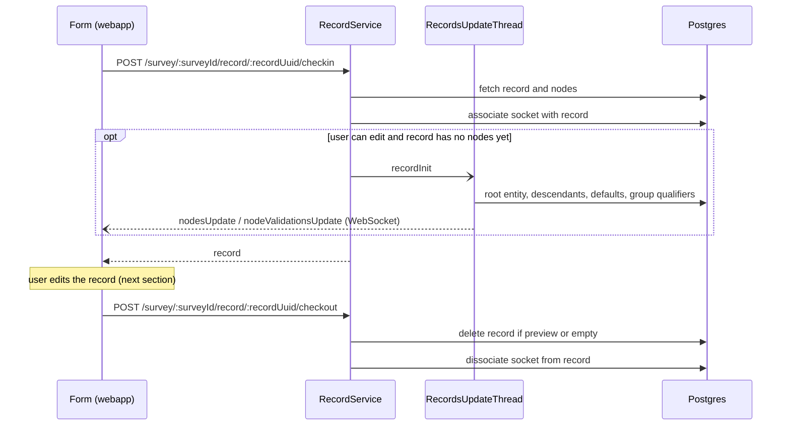
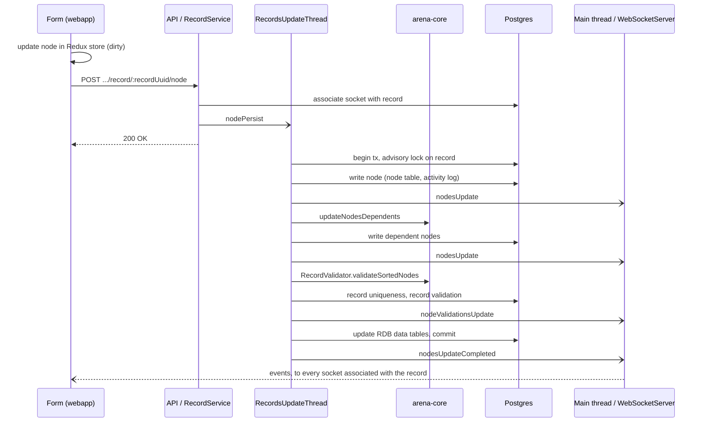

# Record editing

What happens when a user opens a record in the data entry form, edits it and closes it: which code runs
where, and why the flow is asynchronous.

The short version: the browser sends **one node change at a time** and gets an immediate `200 OK`. The
change is applied by a **records update thread** on the server, which also computes every dependent
change (applicability, default values, validation, ...) with the record logic of
[arena-core](https://github.com/openforis/arena-core), persists everything, and pushes the results back
to the browser(s) through the **WebSocket**. The webapp never computes dependent updates itself.

## Where the code lives

| Piece                                 | Location                                                                                                                                                                                                                                                               |
| ------------------------------------- | ---------------------------------------------------------------------------------------------------------------------------------------------------------------------------------------------------------------------------------------------------------------------- |
| Data entry form, Redux actions        | `webapp/components/survey/Record/store/useLocalState.js`, `webapp/store/ui/record/actions/` (`checkIn.js`, `update.js`, `delete.js`, `nodeRequestsQueue.js`)                                                                                                           |
| REST endpoints                        | `server/modules/record/api/recordApi.js` (`.../checkin`, `.../checkout`, `POST`/`DELETE .../node`)                                                                                                                                                                     |
| Service                               | `server/modules/record/service/recordService.js` (`checkIn`, `checkOut`, `persistNode`, `deleteNode`)                                                                                                                                                                  |
| Records update thread                 | `server/modules/record/service/update/`: `surveyRecordsThreadService.js` (main thread side), `thread/recordsUpdateThread.js` (the worker)                                                                                                                              |
| Persistence orchestration             | `server/modules/record/manager/_recordManager/`: `recordUpdateManager.js`, `nodeUpdateManager.js`, `nodeCreationManager.js`, `recordValidationManager.js`, `recordUniquenessValidator.js`, `nodeRDBManager.js`                                                         |
| Record domain logic                   | arena-core `RecordNodesUpdater` (`src/record/recordNodesUpdater/`), `RecordValidator` (`src/record/recordValidator/`), `RecordExpressionEvaluator` (`src/record/recordExpressionEvaluator/`); wrapped by `core/record/record.js` (e.g. `Record.updateNodesDependents`) |
| WebSocket and multi-instance plumbing | arena-server `WebSocketServer` (`src/webSocket/server.ts`), `ClusterBus` (`src/clusterBus/`), `RecordSocketAssociationRepository` (`src/repository/recordSocketAssociation/`)                                                                                          |

## The records update thread

There is **one** worker thread per server instance, shared by all surveys and records
(`SurveyRecordsThreadMap.getKey` is a constant). `RecordsUpdateThreadService.getOrCreatedThread` starts
it lazily (through `server/threads/threadManager.js`, a `node:worker_threads` `Worker`) and kills it after
10 minutes of inactivity.

The worker keeps expression evaluation and record writes off the Express event loop, and its queue
processes messages **one at a time, in arrival order** (`RecordsUpdateThread.onMessage` / `processNext`),
so on one server instance two changes to the same record never interleave.

The thread keeps two idle-expiring caches (`IdleTimeoutCache`):

- **survey data** per survey/cycle/draft (`getOrFetchSurveyData`): the survey with node defs and
  reference data, plus its dependency graph (`Survey.buildDependencyGraph`, i.e. which node defs'
  expressions depend on which others). Big categories and taxonomies are not loaded: their items are
  looked up through `CategoryItemProviderDefault` / `TaxonProviderDefault`. The params the expression
  evaluator needs (user, survey, these providers, `areaOfInterestProvider`, timezone offset, language)
  form a `RecordEvaluationContext` (`core/record/recordEvaluationContext.ts`): on the server, create it
  with `createRecordEvaluationContext` (`server/modules/record/manager/recordEvaluationContextDefault.ts`)
  and spread it in the params of the record update and validation functions, which forward it as a whole.
- **records** (`getOrFetchRecord`): reused only while their `date_modified` still matches the DB,
  otherwise reloaded (see [Several server instances](#several-server-instances)).

Message types are in `thread/recordsThreadMessageTypes.js`: `recordInit`, `nodePersist`, `nodeDelete`,
`recordReload`, `recordClear`, `surveyClear`, `threadKill`.

## Opening and closing a record

**Check-in.** When the record view mounts, `useLocalState` dispatches `RecordActions.checkInRecord`
(`checkIn.js`). `RecordService.checkIn`:

1. loads the record with `RecordManager.fetchRecordAndNodesByUuid`, passing the user so that
   user-dependent applicability is recomputed in memory for the current viewer (not persisted);
2. associates the request's socket with the record (`record_socket_association` table, see below);
3. marks the record read-only if it doesn't match the qualifiers of the user's group (records of other
   groups the user may only read);
4. if the user can edit it and it has no nodes yet, posts `recordInit` to the thread.

Users whose role cannot edit records (Guest role, `surveyGuest` auth group, with the `recordView` permission only) see all the
records (`Authorizer.canViewNotOwnedRecords`), restricted by the qualifiers of their user group if any; the
records summary (`RecordManager.fetchRecordsSummaryBySurveyId`) marks them all as read-only, so Arena
Mobile locks them too.

Reading a record (check-in, record and file download, PDF/DOCX and records export) requires, besides the
role permission, that the user can view it: if the survey security settings don't let the user's role view
records owned by others (`Authorizer.canViewNotOwnedRecords`), only the user's own records
(`recordOwnerMiddleware.ts`), and only records of the user's group or of its readable groups
(`recordQualifierMiddleware.ts`). Records lists, the validation report and its export apply the same
restrictions in their queries.

The same group restriction applies to the Data Explorer queries, counts and exports (and to the map data
export): `SurveyRdbService` fetches the user's group access filters and the data view queries keep only the
records whose qualifier columns in the root entity data view match the user's group or one of the groups it
can read.

A **new record** is created in two steps: `RecordActions.createRecord` posts an empty record
(`POST /survey/:surveyId/record` → `RecordManager.insertRecord`, record row only), then navigates to the
record view, whose check-in triggers `recordInit`. The thread runs `RecordManager.initNewRecord`, which
persists the root entity through the same `persistNode` pipeline described below (so descendants and
default values are created as for any node) and then applies the values of the user's group
qualifiers. The new nodes reach the form via `nodesUpdate` events.

Check-in doesn't lock the record: several users can have it open and edit it at the same time.

**Check-out.** On unmount (and `beforeunload`) the form calls `RecordActions.checkOutRecord`.
`RecordService.checkOut` deletes the record if it is a survey **preview** record (and clears the draft
survey from the thread caches) or if it is still empty, then dissociates the socket. The thread is not
stopped. Logout dissociates the socket from every record (`RecordService.dissocSocketFromUpdateThread`).

## Editing a node

**In the webapp.** `RecordActions.updateNode` (`update.js`) first applies the value to the record in the
Redux store (node flagged dirty), then sends it debounced (500 ms per node, immediately for new
placeholder nodes) as multipart form data, so a file can travel with it. Requests go through
`enqueueNodeRequest` (`nodeRequestsQueue.js`), which sends them one after the other: otherwise e.g. an
attribute of a just added entity could reach the server before the entity. Deletions follow the same
path (`RecordActions.removeNode` → `DELETE .../node/:nodeUuid` → `nodeDelete` message). A "saving"
indicator stays on until `nodesUpdateCompleted` arrives.

**In the API.** `RecordService.persistNode` stores the uploaded file, if any (checking the survey's
file quota), associates the socket with the record and posts a `nodePersist` message to the thread. The
HTTP response only means "queued": results and errors come back over the WebSocket.

**In the thread** (`RecordsUpdateThread.processRecordNodePersistMsg`):

1. `acquireRecordLockAndRun` opens a transaction holding a Postgres advisory lock on the record uuid
   (10 s timeout, mapped to the `record.lockTimeout` error).
2. **Clearing non-applicable values** needs confirmation: unless the survey keeps non-applicable values,
   `RecordManager.findNodeDefUuidsToClearOnNodePersist` dry-runs the dependents update. If values would
   be cleared, only the requesting socket gets `nodesUpdateClearNonApplicableValuesConfirm` and nothing
   is saved; the webapp (`clearNonApplicableValuesConfirm.ts`) resends the change with
   `clearNonApplicableValuesConfirmed`, or reverts it locally if the user cancels.
3. `RecordManager.persistNode` (`recordUpdateManager.js`) runs, in a nested transaction:
   - `_beforeNodeUpdate`: if the node is a root key or a unique root attribute, revalidates the
     uniqueness of the **other** records that shared the old value (they may not be duplicates anymore).
   - **the node itself**: `NodeUpdateManager.updateNode` (existing node; also clears dependent code
     attributes and replaces old files) or `NodeCreationManager.insertNode` (new node; for an entity,
     arena-core `RecordNodesUpdater.addDescendants` creates its descendants in memory). Written to the
     `node` table with an activity log entry. Then a first `nodesUpdate`.
   - **dependent nodes** (`NodeUpdateManager.updateNodesDependents` → `Record.updateNodesDependents` =
     arena-core `RecordNodesUpdater.updateNodesDependents`): walks the dependency graph from the changed
     nodes and runs on each affected node the `dependentsUpdaters`: min/max count, applicability,
     default values (which is also how read-only, "calculated" attributes get their value), editable,
     required, visible, dependent code attributes, enumerated entities, file names. Expressions are
     evaluated by arena-core `RecordExpressionEvaluator`. Each node is visited at most twice, to stop
     loops. This is pure in-memory work; the changed nodes are then written in batch (insert, update,
     delete) and a second `nodesUpdate` is sent.
   - **validation** (`validateNodesAndPersistToRDB`): the changed nodes plus the nodes whose
     validations or min/max counts depend on them are validated by arena-core
     `RecordValidator.validateSortedNodes` (required, value type, validation expressions, entity keys and
     unique attributes among siblings, children count). Record-level uniqueness (root keys, unique root
     attributes) needs the other records, so the server checks it in `RecordUniquenessValidator` against
     the RDB data views. The result is merged into the `record.validation` JSONB column and sent as
     `nodeValidationsUpdate`.
   - **RDB**: `NodeRdbManager.persistNodesToRDB` updates the `survey_<id>_data` tables
     (`DataTableUpdateRepository`), skipped for preview records.
   - `_afterNodesUpdate`: if root keys or unique root attributes changed, validates uniqueness against
     the other records with the new value (persisting their validation too), then updates the record's
     `date_modified`.
4. The updated record is cached with the `date_modified` just written, the transaction commits and
   `nodesUpdateCompleted` is posted.

A `SystemError` (e.g. an expression that cannot be evaluated) becomes an `applicationError` event for
the record; any other error is reported to the user as `threadError`.

This path doesn't use arena-core's higher level `RecordUpdater` (used by Arena Mobile, which updates
dependents and validates in one call): it calls `updateNodesDependents` and `RecordValidator` separately,
to persist and notify between the steps.

## Back to the browser

The worker cannot reach the sockets, so it posts its events to the main thread
(`Thread.postMessage`). There `surveyRecordsThreadService.js` forwards them in order
(`createSequentialThreadMessagesNotifier`) to every socket associated with the record, looked up in
the `record_socket_association` table (arena-server `RecordSocketAssociationRepository`; filled at
check-in and on every node request). This is how other users with the record open see the changes
live. `WebSocketServer.notifySocket` emits directly if the socket is connected to this server instance,
otherwise it relays the event through `ClusterBus`.

In the webapp, `useLocalState` listens to these events and dispatches `recordNodesUpdate` (merges the
nodes into the store and removes the dirty flag), `nodeValidationsUpdate`, `nodesUpdateCompleted`,
`recordDeleted` and `applicationError`.

## Several server instances

Several server instances can share one DB (see [architecture.md](architecture.md)), each with its own
records update thread. Edits to the same record are kept consistent by:

- the **advisory lock** above, which serializes writes to one record across instances;
- the **freshness check** of the records cache: a cached record is reused only if its `date_modified`
  equals the one in the DB, so a change committed by another instance forces a reload;
- **cache clear events**: `clearSurveyDataFromThread` / `clearRecordDataFromThread` publish
  `surveyClear` / `recordClear` on the `ClusterBus` (Postgres `LISTEN/NOTIFY`), handled by the thread of
  every instance, e.g. when a survey is published or a record is deleted;
- the socket associations being stored in the DB rather than in memory.

## Records edited offline in Arena Mobile

They skip the records update thread: Arena Mobile updates and validates records on the device (arena-core
`RecordUpdater`) and uploads them to `POST /api/mobile/survey/:surveyId`, which starts
`ArenaMobileDataImportJob` (`server/modules/mobile/service/arenaMobileDataImport/`). Its
`RecordsImportJob` inserts new records as uploaded, or updates existing ones with
`Record.replaceUpdatedNodes` / `Record.mergeRecords` (`core/record/_record/recordsCombiner.js`, which
rerun dependents and validation), writing nodes and RDB rows in batches.
